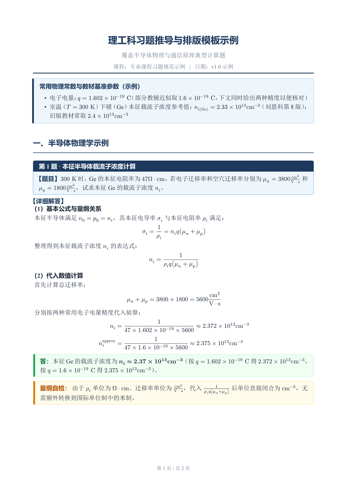
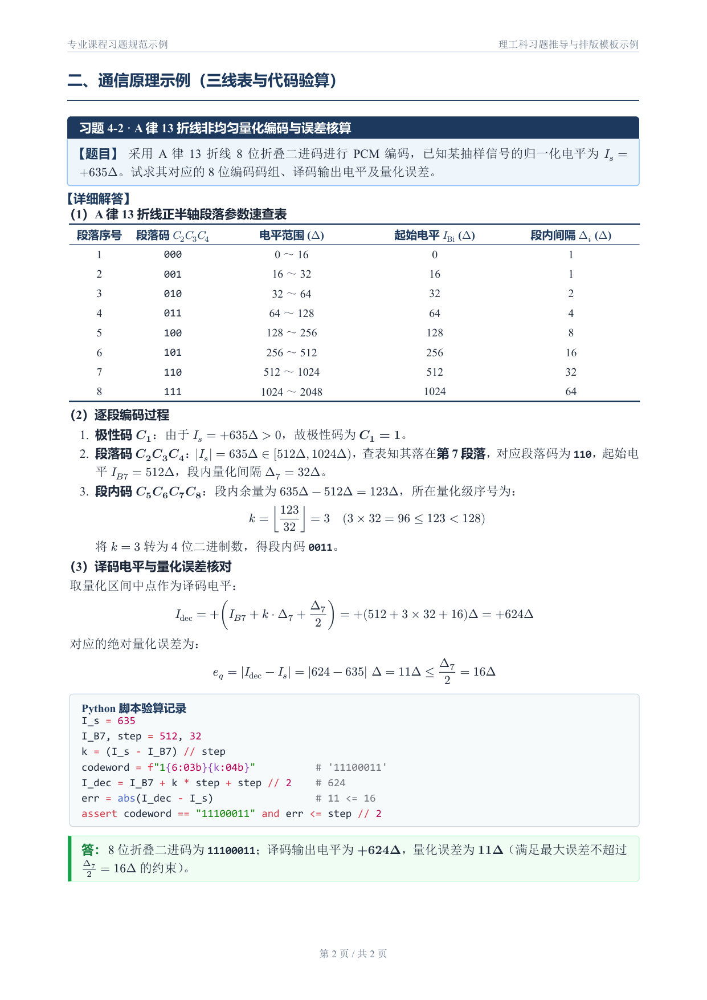

# ee-homework-solver

简体中文 | [English](./README_EN.md)

一个面向电子信息 / 工科（EE/STEM）大学课程习题、实验推导与复习整理的 AI Agent 技能（Skill）。它把**教材与课件精准提取 → Python / SymPy 符号与数值强验算 → Typst 0.15 学术排版 → PyMuPDF 自动检错与视觉复核**固化为一套可复现的端到端工作流，直接输出版面整洁、计算可靠的高清 PDF 解答。

---

## 排版效果预览

以下预览由仓库自带的 [examples/sample_homework.typ](./examples/sample_homework.typ) 通过 `build_homework_pdf.py` 编译并渲染生成：

<table>
  <tr>
    <td align="center"></td>
    <td align="center"></td>
  </tr>
  <tr>
    <td align="center"><sub>第 1 页：标题横幅、常数对照框、半导体推导、结论与量纲自检</sub></td>
    <td align="center"><sub>第 2 页：自动页眉页脚、标准三线表、Python 验算块与结果框</sub></td>
  </tr>
</table>

---

## 核心特性

- **教材与课件按需提取**：通过 `extract_ref.py` 从大部头教材 PDF 提取目录（`toc`）、检索关键词（`search`）、读取指定页（`pages`）或高清渲染扫描页（`render`），并支持按阅读顺序提取 `.docx` / `.pptx`（Windows 下另支持 `.doc` / `.ppt`）中的正文与表格。
- **强制 Python / SymPy 验算**：要求先做符号推导，再用 `sympy`、`numpy`、`scipy` 做数值代入、边界条件与量纲闭合检查；遇到教材不同版次常数差异（如 $q = 1.602 \times 10^{-19}\text{ C}$ 与近似值 $1.6 \times 10^{-19}\text{ C}$）时并行输出双精度结果。
- **开箱即用的 Typst 0.15 学术模板**：
  - 修复 Windows/跨平台宋体缺少真粗体导致中文加粗不明显的问题，显式为标题和加粗映射无衬线粗体栈。
  - 内置 `#ee-doc`、`#constants-box`、`#problem`、`#solution`、`#answer-box`、`#note-box`、`#code-block` 及标准学术三线表 `#three-line-table`。
- **隔离打包编译与自动 QA**：`build_homework_pdf.py` 仅将 `.typ`、模板和实际引用的局部资源复制到临时根目录编译（避免跨盘符报错，也不会误复制同目录下几百 MB 的教材 PDF），编译后自动检测页边距溢出、缺字（`\ufffd`）与末页稀疏问题，并导出每页 PNG 供视觉自检。
- **工程附图支持**：配套 Matplotlib 中文安全绘图配方（支持导出矢量 SVG 与 300 DPI PNG 直接嵌入 Typst）。

---

## 适用课程与典型场景

- **半导体物理学**：本征/杂质载流子浓度、费米能级、迁移率、电导率、PN 结（含刘恩科第 7/8 版基准常数核对）。
- **电子电力技术**：单相/三相整流、有源逆变、换相重叠角、CCM/DCM 临界判据、平均值/RMS 与谐波功率因数（`THD`）。
- **通信原理**：抽样定理、PCM 信息速率、A 律 13 折线 8 位折叠二进码及量化误差、AM/DSB/SSB/FM 带宽与信噪比。
- **微机原理与单片机**：8086 物理地址、补码与标志位（`CF`/`OF`/`ZF`/`SF`/`PF`）、8051/STM32 定时器初值计算。
- **电子线路 / 信号与系统**：直流静态工作点（Q 点）与交流小信号模型、波特图、极零点分析。

---

## 目录结构

```text
ee-homework-solver/
├── SKILL.md                             # Agent 主运行手册（5 步标准化流程）
├── README.md                            # 中文说明文档
├── README_EN.md                         # English README
├── LICENSE                              # MIT 开源协议
├── CHANGELOG.md                         # 版本更新记录
├── requirements.txt                     # Python 依赖清单
├── .gitignore
├── assets/                              # README 展示用预览图
│   ├── preview_page_01.png
│   └── preview_page_02.png
├── resources/
│   └── ee_homework_tpl.typ              # Typst 0.15 统一排版模板
├── scripts/
│   ├── build_homework_pdf.py            # 隔离编译与 PyMuPDF 自动 QA 脚本
│   └── extract_ref.py                   # PDF / Office 教材课件提取脚本
├── references/
│   ├── typst-math-cheatsheet.md         # LaTeX → Typst 公式/单位写法避坑表
│   └── subject-checklists.md            # 分学科验算清单与 Matplotlib 中文绘图规范
└── examples/
    └── sample_homework.typ              # 可直接编译的模板示例
```

---

## 安装与配置

### 1. 安装 Python 依赖

建议使用 **Python 3.10+**（无需额外安装本地 LaTeX 发行版，Typst 由 Python 包自带编译引擎）：

```bash
pip install -r requirements.txt
```

> 注：如果需要在 Windows 上直接提取旧版 `.doc` / `.ppt` 二进制文件，可额外安装 `pip install pywin32`（需本机已装 Microsoft Office）；macOS / Linux 建议先通过 LibreOffice 转为 `.docx` / `.pptx`。

### 2. 安装到 AI Agent 的 Skills 目录

将本仓库克隆（或下载解压）到你使用的 AI Agent 对应的全局或项目级 `skills` 目录（保持目录结构不变）：

- **Antigravity**：`~/.gemini/config/skills/ee-homework-solver`（或工作区 `.agents/skills/ee-homework-solver`）
- **Cursor**：`~/.cursor/skills/ee-homework-solver`
- **Claude Code**：`~/.claude/skills/ee-homework-solver`
- **Codex**：`~/.codex/skills/ee-homework-solver`

---

## 使用方法

### 对话式调用（推荐）

安装后你无需手动运行脚本，只需在支持 Skill 的 AI 对话中给出题目截图、教材 PDF 或作业文档路径即可，例如：

- *"帮我做一下这几道半导体物理第 4 章习题（附上题目照片或教材 PDF），用 Python 验算并输出排版好的 PDF 解答。"*
- *"请对照课件 `通信原理-第4章.pptx` 的公式范围，完成 `习题-第4章.docx` 里的 PCM 编码计算并生成 PDF。"*
- *"用 `@ee-homework-solver` 帮我核对这张电力电子三相桥整流题的推导过程和功率因数计算。"*

### 独立命令行使用（也可手动运行）

**编译示例 `.typ` 文件并输出逐页 QA 预览图：**

```bash
python -B scripts/build_homework_pdf.py examples/sample_homework.typ out/sample_homework.pdf --preview-dir out/pages
```

**检索与提取教材/课件内容：**

```bash
# 查看 PDF 书签目录
python -B scripts/extract_ref.py toc textbook.pdf

# 关键词检索页码与上下文片段
python -B scripts/extract_ref.py search textbook.pdf "本征载流子"

# 提取指定页文本（如 1,3-5,107）
python -B scripts/extract_ref.py pages textbook.pdf 107,112-114

# 将扫描版教材的指定页渲染为高清 PNG
python -B scripts/extract_ref.py render scanned_book.pdf 107-108 --out-dir out/ref_pages

# 提取 Word / PPT 中的文本与表格
python -B scripts/extract_ref.py office slides.pptx
```

---

## 开源协议

本项目基于 [MIT License](./LICENSE) 开源。
