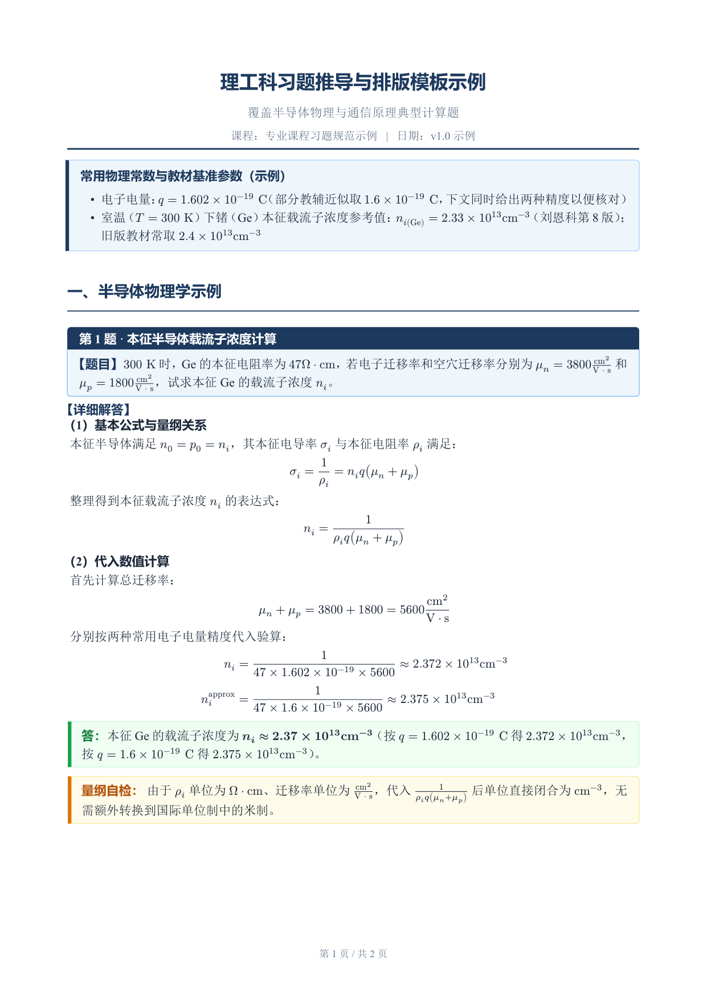
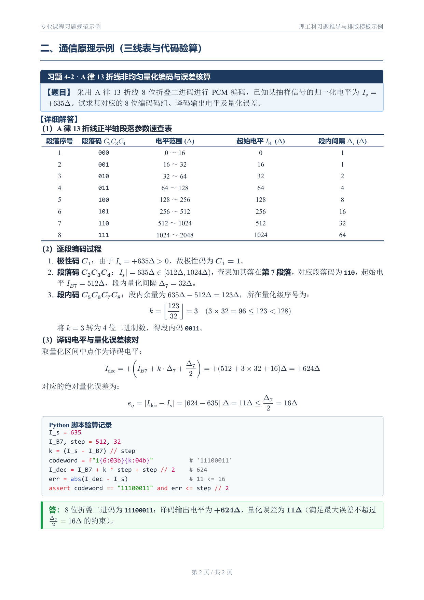

# ee-homework-solver

[简体中文](./README.md) | English

An AI Agent Skill for solving university Electrical Engineering / STEM homework and engineering exercises with grounded textbook extraction, mandatory Python/SymPy verification, Typst 0.15 typesetting, and PyMuPDF visual QA.

---

## Output Preview

Generated directly from [examples/sample_homework.typ](./examples/sample_homework.typ) via `build_homework_pdf.py`:

<table>
  <tr>
    <td align="center"></td>
    <td align="center"></td>
  </tr>
  <tr>
    <td align="center"><sub>Page 1: Title banner, reference constants, derivation, answer box & unit check</sub></td>
    <td align="center"><sub>Page 2: Running header/footer, academic three-line table & Python check block</sub></td>
  </tr>
</table>

---

## Key Features

- **Grounded Reference Extraction (`scripts/extract_ref.py`)**: Extract PDF bookmarks (`toc`), search keywords (`search`), pull specific pages (`pages`), render scanned textbook pages to PNG (`render`), and extract structured text/tables from `.docx` / `.pptx` (plus `.doc` / `.ppt` via Office COM on Windows).
- **Mandatory Python / SymPy Verification**: Derives expressions symbolically first, then verifies numerical substitutions, edge cases, and unit/dimensional closure using `sympy`, `numpy`, and `scipy`. Prints dual-precision values when textbook editions use slightly different physical constants.
- **Cross-Platform Typst 0.15 Academic Template (`resources/ee_homework_tpl.typ`)**:
  - Cross-platform CJK font stacks (Windows / macOS / Linux) with explicit sans-serif bold mapping so Chinese bold text stays crisp.
  - Built-in helpers: `#ee-doc`, `#constants-box`, `#problem`, `#solution`, `#answer-box`, `#note-box`, `#code-block`, and `#three-line-table`.
- **Isolated Staging Build & Automated PDF QA (`scripts/build_homework_pdf.py`)**: Stages only the `.typ` file, template, and referenced local assets in a temporary root (preventing cross-drive path issues and avoiding copying giant textbook PDFs), then checks for margin overflow, missing glyphs (`\ufffd`), sparse last pages, and renders page PNGs for visual inspection.

---

## Supported Subjects

- **Semiconductor Physics**: Carrier concentrations, Fermi levels, mobility, resistivity, PN junctions.
- **Power Electronics**: Controlled rectifiers, active inversion, commutation overlap, CCM/DCM modes, RMS/average values, `THD` and power factor.
- **Communication Principles**: Nyquist sampling, PCM bitrate, A-law 13-segment 8-bit encoding & quantization error, AM/DSB/SSB/FM bandwidth and SNR.
- **Microcomputers & MCUs**: 8086 physical addressing, two's complement & CPU flags (`CF`, `OF`, `ZF`, `SF`, `PF`), 8051/STM32 timer reload calculations.
- **Analog / RF Circuits & Signals**: DC Q-point & AC small-signal analysis, poles/zeros, Bode plots.

---

## Installation

### 1. Install Python Dependencies

Requires **Python 3.10+** (no separate LaTeX distribution needed; the `typst` Python package bundles the Typst compiler):

```bash
pip install -r requirements.txt
```

> Note: On Windows, you can optionally install `pip install pywin32` to read legacy `.doc` / `.ppt` files via local Office COM. On macOS/Linux, convert legacy files to `.docx` / `.pptx` with LibreOffice first.

### 2. Add to Your Agent's Skills Directory

Clone or copy this folder into your AI Agent's skills directory while keeping the directory layout intact:

- **Antigravity**: `~/.gemini/config/skills/ee-homework-solver` (or workspace `.agents/skills/ee-homework-solver`)
- **Cursor**: `~/.cursor/skills/ee-homework-solver`
- **Claude Code**: `~/.claude/skills/ee-homework-solver`
- **Codex**: `~/.codex/skills/ee-homework-solver`

---

## Quick CLI Usage

Compile the bundled example and render per-page PNG previews:

```bash
python -B scripts/build_homework_pdf.py examples/sample_homework.typ out/sample_homework.pdf --preview-dir out/pages
```

Extract textbook or slide references:

```bash
python -B scripts/extract_ref.py toc textbook.pdf
python -B scripts/extract_ref.py search textbook.pdf "intrinsic carrier"
python -B scripts/extract_ref.py pages textbook.pdf 107,112-114
python -B scripts/extract_ref.py render scanned_book.pdf 107-108 --out-dir out/ref_pages
python -B scripts/extract_ref.py office slides.pptx
```

---

## License

Released under the [MIT License](./LICENSE).
